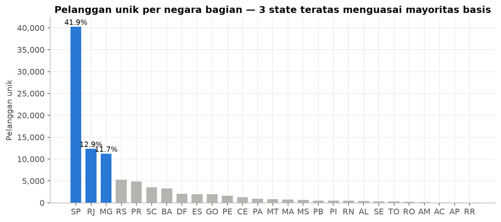
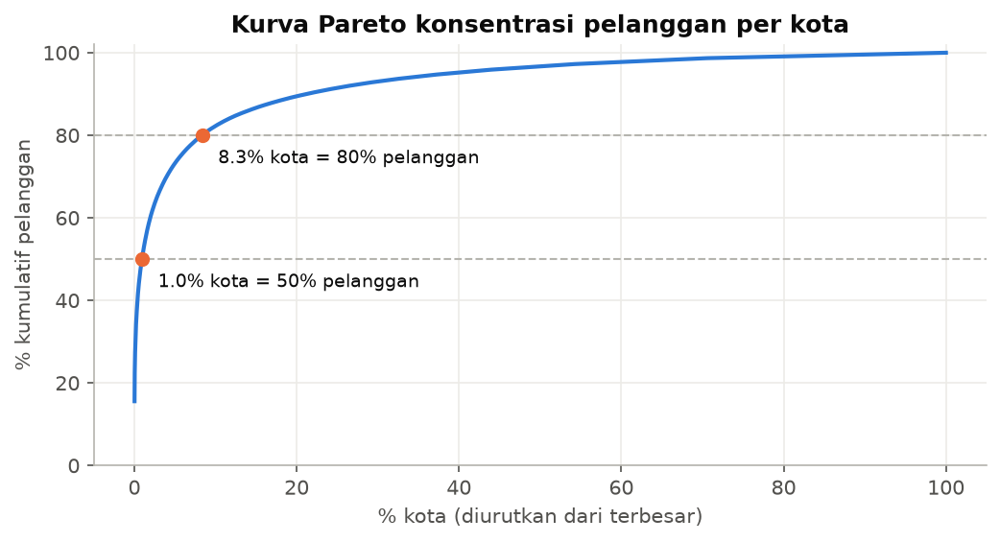
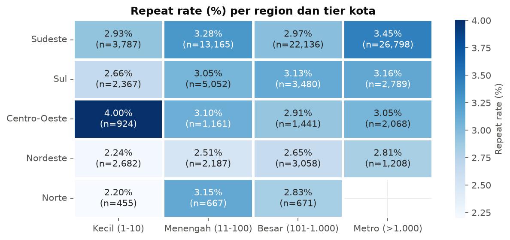
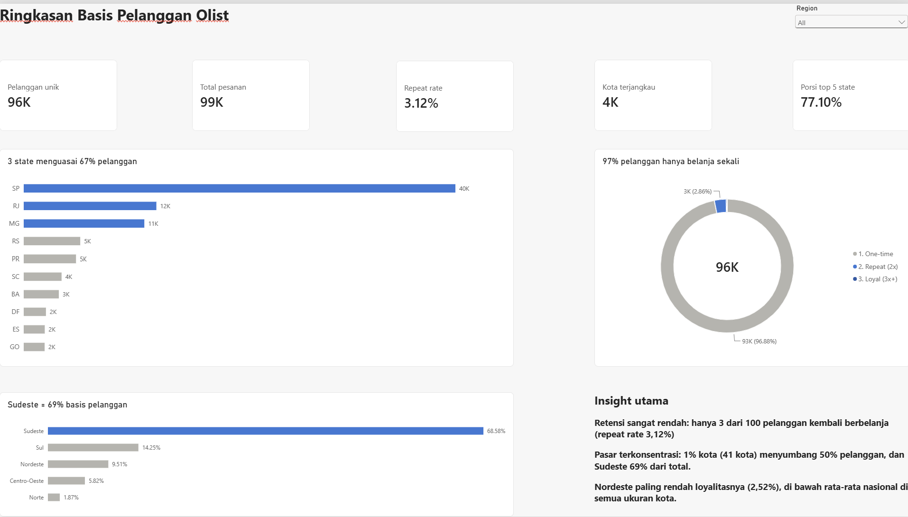

# Olist Customer Geography & Loyalty Analysis

Proyek Business Analyst end-to-end yang mencakup business understanding, data cleaning, EDA, KPI, SQL, desain Power BI, dan rekomendasi bisnis. Proyek ini memakai data pelanggan marketplace e-commerce Brasil (Olist).

## Project Overview
Proyek ini menganalisis 99.441 record pelanggan untuk menjawab tiga pertanyaan: **di mana pelanggan berada, seberapa terkonsentrasi pasarnya, dan seberapa loyal pelanggannya.**

## Business Problem
Manajemen belum mengetahui seberapa besar ketergantungan bisnis pada wilayah tertentu dan seberapa sering pelanggan kembali berbelanja. Akibatnya, keputusan ekspansi wilayah, logistik, dan anggaran retensi belum memiliki dasar data yang kuat.

## Objectives
1. Memetakan distribusi dan konsentrasi pelanggan per region, state, dan kota.
2. Mengukur repeat customer rate dan membuat segmentasi berdasarkan frekuensi.
3. Membandingkan tingkat loyalitas antarwilayah dan antar-ukuran kota.
4. Menyiapkan model data dan dashboard Power BI.

## Dataset Description
`olist_customers_dataset.csv` berisi 99.441 baris × 5 kolom (`customer_id`, `customer_unique_id`, `customer_zip_code_prefix`, `customer_city`, `customer_state`). Tidak ada missing value maupun duplikat.
Dataset ini **tidak memiliki** data transaksi atau tanggal, sehingga revenue dan time series berada di luar cakupan (lihat bagian Limitations di laporan).

Sumber: [Brazilian E-Commerce Public Dataset by Olist](https://www.kaggle.com/datasets/olistbr/brazilian-ecommerce) di Kaggle, lisensi CC BY-NC-SA 4.0.

## Tools and Technologies
Python (Pandas, NumPy, Matplotlib, Seaborn, SciPy) · Jupyter · SQL (ANSI, diuji di SQLite) · Power BI (Power Query M, DAX)

## Project Structure
```
business-analyst-project/
├── data/raw/                      # data asli (tidak diubah)
├── data/processed/                # customers_clean, dim_customer, dim_city, dim_state, kpi_summary, cleaning_log
├── scripts/data_cleaning.py       # pipeline cleaning + validasi
├── scripts/build_notebook.py      # generator notebook EDA
├── notebooks/exploratory_data_analysis.ipynb
├── sql/business_analysis.sql      # 9 query KPI & analisis
├── powerbi/business_dashboard.pbix  # file dashboard Power BI
├── powerbi/powerbi_guide.md       # data model, Power Query, layout dashboard
├── powerbi/measures.dax           # seluruh DAX measure
├── powerbi/olist_theme.json       # tema warna dashboard
├── reports/business_analysis_report.pdf   # (+ .md sumber, .html antara)
├── scripts/build_report_pdf.py
├── visuals/                       # 8 grafik PNG
├── README.md
└── requirements.txt
```

## Analysis Process
1. **Business understanding:** merumuskan problem statement, stakeholder, dan pertanyaan bisnis.
2. **Data understanding:** memeriksa tipe data, missing value, duplikat, keunikan, dan konsistensi.
3. **Data cleaning:** standarisasi format, validasi, perbaikan 6 grup ejaan kota, feature engineering, dan flag outlier.
4. **EDA:** analisis univariate, bivariate (chi-square, Spearman, Wilson CI), multivariate (heatmap, bubble), dan Pareto.
5. **KPI:** dihitung dengan Python, SQL, dan DAX.
6. **Power BI:** star schema, Power Query, DAX, serta 3 halaman dashboard + 1 drill-through.
7. **Insight dan rekomendasi** yang dikelompokkan dalam matriks impact/effort.

Cara menjalankan:
```bash
pip install -r requirements.txt
python scripts/data_cleaning.py
python scripts/build_notebook.py
jupyter nbconvert --to notebook --execute --inplace notebooks/exploratory_data_analysis.ipynb
python scripts/build_report_pdf.py   # Markdown -> PDF (butuh Microsoft Edge/Chrome)
```

## Key Findings
| # | Temuan | Bukti |
|---|---|---|
| 1 | Retensi sangat rendah | 96,88% pelanggan one-time; repeat rate **3,12%** |
| 2 | Pasar sangat terkonsentrasi | Sudeste 68,56%, SP 41,93%; **1% kota = 50% pelanggan**; HHI 2.164 |
| 3 | Loyalitas di Nordeste lebih rendah | 2,52% vs Sudeste 3,23% (χ² p = 0,006); Fortaleza 1,87% |
| 4 | Kota kecil kurang loyal | Repeat 2,75% vs metro 3,37% (p = 0,002); 1.290 kota hanya punya 1 pelanggan |





## Dashboard Preview
File dashboard: [`powerbi/business_dashboard.pbix`](powerbi/business_dashboard.pbix). Untuk membukanya, unduh file tersebut lalu buka di Power BI Desktop.



Model data, langkah Power Query, dan rancangan tiap halaman dijelaskan di [`powerbi/powerbi_guide.md`](powerbi/powerbi_guide.md).

## Business Recommendations
- **High Impact / Low Effort:** program retensi pasca-pembelian (voucher pembelian kedua, reminder H+7/H+30) dengan A/B test; menjaga SLA di 9 kota metro yang menyumbang 34% pelanggan; mengintegrasikan data orders, payments, dan reviews.
- **High Impact / High Effort:** mendiagnosis delivery time dan review score di Nordeste sebelum menambah belanja akuisisi; pilot subsidi ongkir atau rekrutmen penjual lokal di Salvador, Fortaleza, dan Recife.
- **Low Impact / Low Effort:** validasi alamat berbasis CEP saat checkout.
- **Low Impact / High Effort:** model pick-up point untuk kota kecil.

## Project Conclusion
Basis pelanggan Olist luas (4.304 kota) tetapi dangkal: terkonsentrasi di Sudeste dan didominasi pelanggan one-time. Prioritas utamanya adalah **retensi**, bukan ekspansi. Langkah berikutnya adalah melengkapi data transaksi untuk menguji hipotesis penyebab dan mengukur dampak finansialnya.

Laporan lengkap: [PDF](reports/business_analysis_report.pdf) · [Markdown](reports/business_analysis_report.md)
