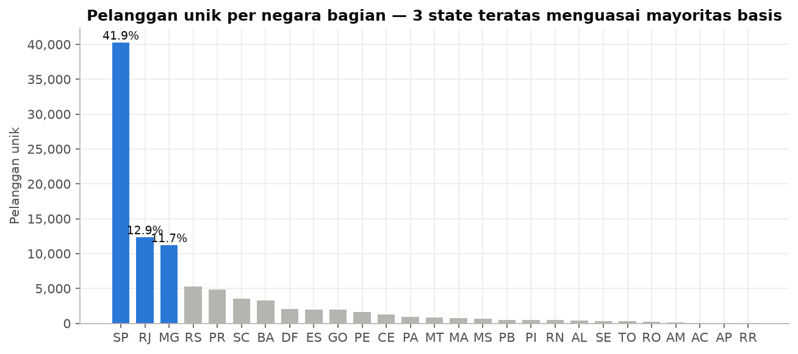
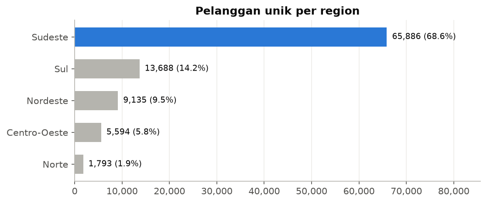
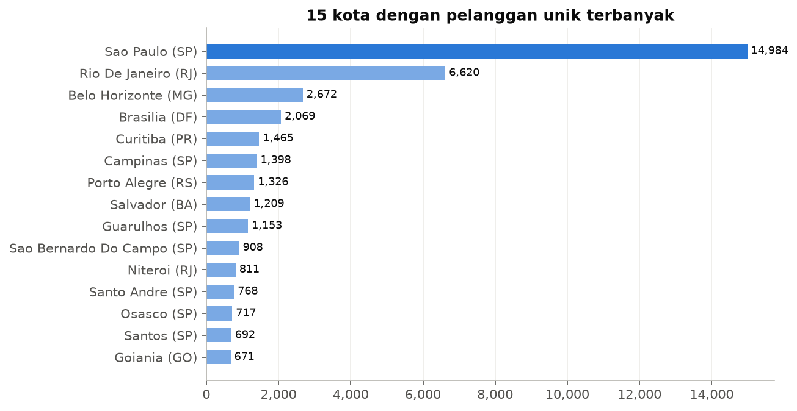
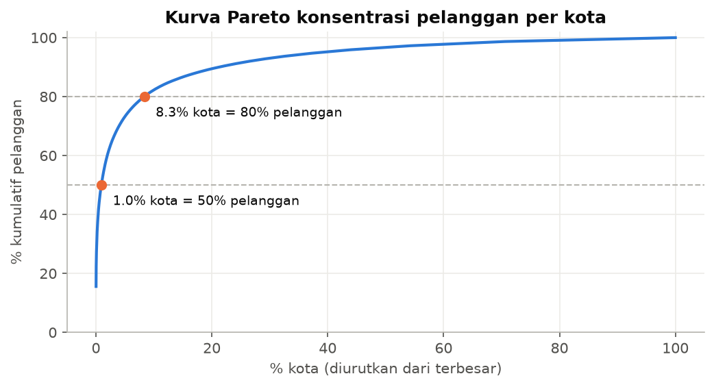
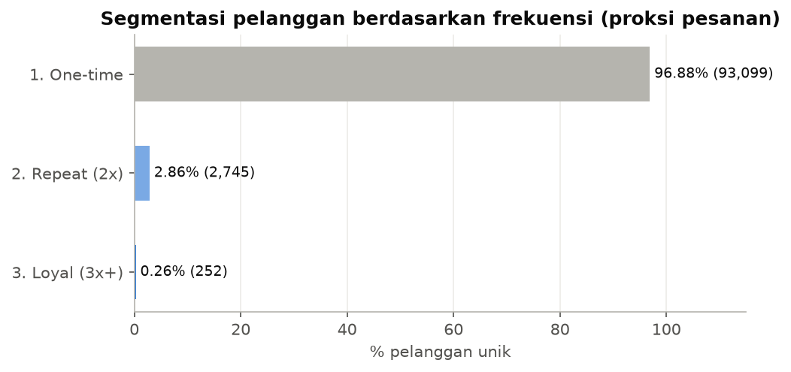
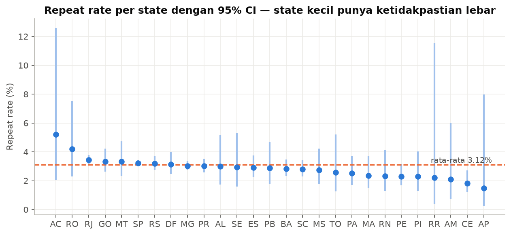
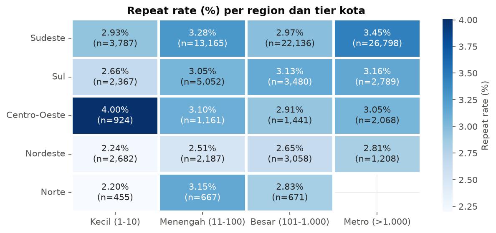
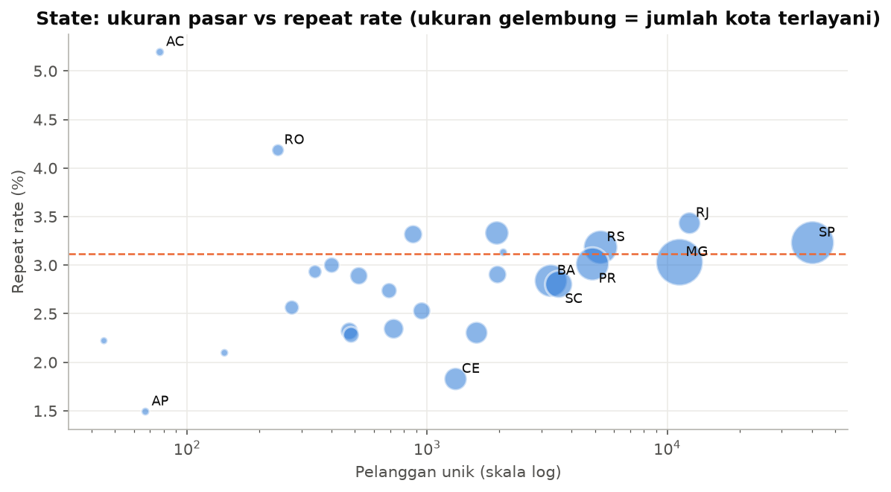

# Analisis Basis Pelanggan Olist

Sumber data: olist_customers_dataset.csv (99.441 baris, 5 kolom)
Disusun: November 2026

---

## 1. Executive Summary

Olist punya 96.096 pelanggan unik di 27 negara bagian dan 4.304 kota. Jangkauannya luas, tetapi sebarannya tidak merata. Region Sudeste menyumbang 68,56% pelanggan, dan São Paulo sendiri sudah 41,93%. Kalau dilihat per kota, 41 kota teratas (sekitar 1% dari semua kota) sudah mencakup separuh basis pelanggan.

Temuan yang paling perlu diperhatikan adalah soal loyalitas. Sebanyak 96,88% pelanggan hanya tercatat satu kali. Hanya 2.997 orang, atau 3,12%, yang pernah kembali berbelanja. Artinya, pertumbuhan Olist saat ini hampir seluruhnya bergantung pada pelanggan baru.

Tingkat pembelian ulang juga sedikit berbeda antarwilayah. Nordeste paling rendah (2,52%), sedangkan Sudeste 3,23%. Kota besar juga lebih baik daripada kota kecil, yaitu 3,37% berbanding 2,75%. Kedua selisih ini signifikan secara statistik, tetapi besarnya kurang dari satu poin persentase.

Ada tiga hal yang kami sarankan untuk didahulukan:

1. Program retensi untuk pelanggan yang baru sekali belanja.
2. Pengecekan pengalaman pengiriman di Nordeste sebelum menambah anggaran akuisisi di sana.
3. Melengkapi data transaksi agar dampaknya bisa diukur dalam rupiah, bukan hanya jumlah pelanggan.

## 2. Business Background

Olist adalah marketplace asal Brasil yang membantu penjual kecil dan menengah berjualan di kanal-kanal marketplace besar. Dataset publiknya berisi sekitar 100 ribu pesanan dari periode 2016 sampai 2018 dan terdiri dari sembilan tabel. Untuk analisis ini, data yang tersedia hanya tabel pelanggan. Gambaran bisnis di atas diambil dari dokumentasi publik dataset, bukan dari isi tabel itu sendiri.

## 3. Problem Statement

Saat ini belum ada gambaran yang jelas tentang dua hal. Pertama, di mana pelanggan berada dan seberapa besar bisnis bergantung pada wilayah tertentu. Kedua, berapa banyak pelanggan yang kembali berbelanja, dan apakah angkanya berbeda di tiap wilayah. Tanpa jawaban ini, keputusan ekspansi wilayah, penempatan logistik, dan anggaran retensi lebih banyak didasarkan pada intuisi.

## 4. Business Objectives

1. Memetakan sebaran dan tingkat konsentrasi pelanggan per region, negara bagian, dan kota.
2. Mengukur tingkat pembelian ulang dan mengelompokkan pelanggan berdasarkan frekuensi belanja.
3. Menemukan wilayah yang loyalitasnya di atas atau di bawah rata-rata.
4. Menyiapkan model data dan dashboard Power BI untuk pemantauan rutin.

Pihak yang paling berkepentingan dengan hasil analisis ini:

| Stakeholder | Kepentingan |
|---|---|
| Head of Growth / Marketing | Penentuan wilayah akuisisi dan program retensi |
| Head of Logistics | Prioritas gudang dan target waktu kirim per wilayah |
| Tim CRM | Daftar pelanggan loyal dan pelanggan sekali beli |
| Manajemen | Risiko ketergantungan pada satu pasar dan arah ekspansi |

Pertanyaan yang ingin dijawab:

1. Wilayah mana yang menjadi tulang punggung bisnis?
2. Seberapa terkonsentrasi pasar Olist?
3. Berapa persen pelanggan yang kembali berbelanja?
4. Apakah loyalitas berbeda menurut region dan ukuran kota?
5. Wilayah mana yang paling layak dijadikan target berikutnya?

## 5. Dataset Overview

| Kolom | Tipe | Nilai unik | Kegunaan |
|---|---|---|---|
| customer_id | teks, 32 karakter | 99.441 | ID per pesanan, dipakai untuk join ke tabel orders |
| customer_unique_id | teks, 32 karakter | 96.096 | ID orang, dasar perhitungan pembelian ulang |
| customer_zip_code_prefix | teks, 5 digit | 14.994 | Lokasi yang lebih detail |
| customer_city | teks | 4.119 nama (4.304 pasangan kota dan negara bagian) | Analisis per kota |
| customer_state | teks, kode 2 huruf | 27 | Analisis per negara bagian dan region |

Asumsi yang dipakai: setiap customer_id mewakili satu pesanan. Ini sesuai dengan dokumentasi dataset Olist. Karena itu, jumlah customer_id per orang kami gunakan sebagai pendekatan jumlah pesanan. Angka ini tetap perlu dicek ulang jika data pesanan sudah tersedia.

## 6. Data Quality Assessment

Secara umum datanya bersih. Tidak ada nilai kosong dari 497.205 sel, tidak ada baris ganda, dan tidak ada customer_id yang muncul dua kali. Format ID, kode pos, dan kode negara bagian semuanya valid.

Ada beberapa hal kecil yang tetap perlu ditangani:

| Temuan | Jumlah | Penanganan |
|---|---|---|
| Kode pos berawalan nol (misalnya 01151) | 23.995 baris (24,1%), semuanya di SP | Dibaca sebagai teks agar angka nol di depan tidak hilang |
| Nama kota yang sama di negara bagian berbeda | 163 nama | Analisis memakai gabungan kota dan negara bagian |
| Ejaan kota berbeda untuk kota yang sama | 6 kasus | Disamakan ke ejaan yang paling sering dipakai |
| Pelanggan dengan lebih dari satu alamat | 250 orang, 39 di antaranya pindah negara bagian | Lokasi utama diambil dari alamat yang paling sering dipakai |

Kendala utama dataset ini bukan kualitasnya, melainkan cakupannya. Tidak ada informasi harga, produk, maupun tanggal.

## 7. Data Cleaning Process

Seluruh proses ada di scripts/data_cleaning.py. File mentah tidak diubah, dan hasilnya disimpan terpisah di folder data/processed.

| Langkah | Yang dilakukan | Alasan |
|---|---|---|
| 1 | Membaca semua kolom sebagai teks | Menjaga angka nol di depan kode pos |
| 2 | Mengecek nilai kosong dan duplikat | Hanya validasi; tidak ada data yang perlu dihapus |
| 3 | Merapikan spasi, membuat kode pos menjadi 5 digit, kode negara bagian huruf besar, nama kota huruf kecil tanpa aksen | Supaya formatnya seragam |
| 4 | Mengecek format ID, kode pos, dan kode negara bagian | Memastikan tidak ada nilai yang tidak masuk akal |
| 5 | Menyamakan 6 ejaan kota, misalnya "mogi-mirim" menjadi "mogi mirim" | Supaya satu kota tidak terhitung dua kali |
| 6 | Menambah kolom baru: kunci kota dan negara bagian, nama negara bagian, region, jumlah pesanan per pelanggan, status pelanggan ulang | Kebutuhan analisis dan Power BI |
| 7 | Menandai 19 pelanggan dengan 5 pesanan atau lebih (maksimal 17) | Tidak dihapus karena kemungkinan mereka memang pelanggan setia atau reseller |
| 8 | Membuat tabel pelanggan (96.096 baris), tabel kota (4.304), dan tabel negara bagian (27) | Untuk model data Power BI |
| 9 | Pengecekan akhir: jumlah baris tetap 99.441 dan semua kunci tersambung | Memastikan proses cleaning tidak menimbulkan kesalahan baru |

Jumlah baris sebelum dan sesudah cleaning sama, yaitu 99.441. Jumlah kolom bertambah dari 5 menjadi 12. Kolom nama negara bagian dan region tidak ada di data asli. Kolom ini ditambahkan dari pembagian wilayah resmi IBGE.

## 8. Exploratory Data Analysis

Semua angka di bagian ini berasal dari notebooks/exploratory_data_analysis.ipynb.

### 8.1 Sebaran pelanggan

São Paulo jauh di depan dengan 40.291 pelanggan, atau 41,93% dari total. Di belakangnya ada Rio de Janeiro (12,88%) dan Minas Gerais (11,71%). Tiga negara bagian ini saja sudah mencakup dua pertiga basis pelanggan. Ketimpangannya juga terlihat dari perbandingan rata-rata dan median: rata-rata pelanggan per negara bagian adalah 3.559, tetapi mediannya hanya 874.

Per region, Sudeste mendominasi dengan 68,56%. Setelah itu Sul 14,24%, Nordeste 9,51%, Centro-Oeste 5,82%, dan Norte hanya 1,87%.

Di level kota polanya sama. Separuh kota hanya punya 3 pelanggan atau kurang, dan 1.290 kota (30%) hanya punya satu pelanggan. Di sisi lain, kota São Paulo sendiri punya 14.984 pelanggan.

Kurva Pareto di bawah memperjelas hal ini. Sebanyak 1% kota mencakup 50% pelanggan, dan 8,3% kota mencakup 80%. Indeks Gini antarkota sebesar 0,861. Indeks HHI per negara bagian sebesar 2.164, yang masuk kategori konsentrasi sedang dan sudah dekat dengan batas tinggi (2.500).

### 8.2 Frekuensi belanja

Rata-rata pelanggan hanya tercatat 1,035 kali. Median dan modusnya sama-sama 1. Dari 96.096 pelanggan, 93.099 hanya belanja sekali, 2.745 belanja dua kali, dan hanya 252 yang belanja tiga kali atau lebih. Pelanggan dengan frekuensi tertinggi tercatat 17 kali.

### 8.3 Loyalitas per wilayah

| Region | Pelanggan | Tingkat pembelian ulang |
|---|---|---|
| Sudeste | 65.886 | 3,23% |
| Centro-Oeste | 5.594 | 3,18% |
| Sul | 13.688 | 3,02% |
| Norte | 1.793 | 2,79% |
| Nordeste | 9.135 | 2,52% |

Perbedaan antarregion ini signifikan secara statistik (uji chi-square, p = 0,006). Di level negara bagian, Ceará (1,83%) dan Pernambuco (2,30%) paling rendah di antara negara bagian yang punya lebih dari 1.000 pelanggan. Rio de Janeiro paling tinggi di antara negara bagian besar, dengan 3,43%.

Acre (5,19%) dan Rondônia (4,18%) memang terlihat tinggi. Namun jumlah pelanggannya sangat sedikit, hanya 77 dan 239 orang, sehingga angkanya belum bisa dijadikan pegangan. Garis vertikal pada grafik di bawah menunjukkan rentang ketidakpastian untuk setiap negara bagian.

Negara bagian yang pelanggannya lebih banyak cenderung punya tingkat pembelian ulang yang sedikit lebih tinggi. Namun hubungannya lemah (korelasi Spearman 0,385).

Pola serupa terlihat ketika kota dikelompokkan berdasarkan jumlah pelanggannya:

| Ukuran kota | Jumlah kota | Pelanggan | Porsi | Tingkat pembelian ulang |
|---|---|---|---|---|
| Kecil (1 sampai 10 pelanggan) | 3.452 | 10.215 | 10,63% | 2,75% |
| Menengah (11 sampai 100) | 721 | 22.232 | 23,14% | 3,14% |
| Besar (101 sampai 1.000) | 122 | 30.786 | 32,04% | 2,95% |
| Metro (lebih dari 1.000) | 9 | 32.863 | 34,20% | 3,37% |

Perbedaan ini juga signifikan secara statistik (p = 0,002).

### 8.4 Region dan ukuran kota sekaligus

Ketika region dan ukuran kota dilihat bersama, Nordeste konsisten berada di bawah rata-rata nasional untuk semua ukuran kota, yaitu antara 2,24% dan 2,81%. Sel dengan nilai tertinggi yang datanya cukup besar adalah kota metro di Sudeste, dengan 3,45% dari 26.798 pelanggan. Angka 4,00% untuk kota kecil di Centro-Oeste hanya berasal dari 924 pelanggan, jadi perlu dibaca dengan hati-hati.

Pada grafik gelembung di bawah, negara bagian besar seperti SP, RJ, MG, dan RS berada di sekitar atau di atas rata-rata. Sebaliknya, negara bagian di Nordeste dengan jumlah pelanggan menengah, seperti CE, PE, MA, PI, dan RN, berkumpul di bawah garis rata-rata.

### 8.5 Pelanggan yang berpindah alamat

Dari 2.997 pelanggan yang belanja lebih dari sekali, 250 orang memakai lebih dari satu kode pos. Sebanyak 122 orang tercatat di lebih dari satu kota, dan 39 orang di lebih dari satu negara bagian. Penyebab pastinya belum diketahui. Kemungkinannya antara lain pindah rumah, mengirim barang sebagai hadiah, atau bergantian memakai alamat rumah dan kantor.

## 9. KPI Analysis

| KPI | Cara menghitung | Nilai | Catatan |
|---|---|---|---|
| Pelanggan unik | jumlah customer_unique_id yang berbeda | 96.096 | Ukuran basis pelanggan |
| Total pesanan (perkiraan) | jumlah customer_id | 99.441 | Didasarkan pada asumsi 1 ID = 1 pesanan |
| Tingkat pembelian ulang | pelanggan dengan lebih dari 1 pesanan dibagi pelanggan unik | 3,12% | Sangat rendah |
| Rata-rata pesanan per pelanggan | total pesanan dibagi pelanggan unik | 1,035 | Hampir semua hanya sekali beli |
| Pelanggan loyal | pelanggan dengan 3 pesanan atau lebih | 252 | Kelompok yang sangat kecil |
| Porsi 5 negara bagian teratas | pelanggan di 5 negara bagian teratas dibagi total | 77,09% | Ketergantungan tinggi |
| Porsi 10 kota teratas | pelanggan di 10 kota teratas dibagi total | 35,13% | Terkumpul di kota besar |
| HHI negara bagian | jumlah kuadrat porsi tiap negara bagian | 2.164 | Konsentrasi sedang, mendekati tinggi |
| Kota yang mencakup 80% pelanggan | analisis Pareto | 8,34% | Pasar bertumpu pada sedikit kota |
| Kota yang terjangkau | jumlah pasangan kota dan negara bagian | 4.304 | Jangkauan luas tetapi tipis |

Rumus yang sama tersedia dalam SQL (sql/business_analysis.sql) dan DAX (powerbi/measures.dax).

## 10. Key Business Findings

**Pelanggan hampir tidak pernah kembali.** Dari 100 pelanggan, hanya sekitar 3 yang belanja lagi. Ini berarti biaya untuk mendapatkan pelanggan baru hampir tidak pernah tertutup oleh pembelian berikutnya. Setiap kenaikan satu poin persentase setara dengan sekitar 960 pelanggan tambahan yang kembali berbelanja. Kemungkinan penyebabnya ada beberapa: produk yang dijual memang jarang dibeli ulang, pelanggan tidak sadar bahwa mereka belanja lewat Olist karena transaksinya terjadi di marketplace lain, atau pengalaman pengirimannya kurang baik. Dugaan ini baru bisa dibuktikan dengan data pesanan, produk, dan ulasan.

**Bisnis sangat bergantung pada Sudeste, terutama São Paulo.** Dua dari tiga pelanggan berada di tiga negara bagian saja. Gangguan di wilayah ini, baik dari sisi logistik, persaingan, maupun ekonomi lokal, akan langsung terasa pada keseluruhan bisnis. Di sisi lain, kepadatan pelanggan ini juga memberi peluang untuk efisiensi pengiriman. Kami menduga konsentrasi ini sebagian besar mencerminkan jumlah penduduk dan daya beli. Untuk memastikannya, data populasi perlu ditambahkan agar penetrasi per kapita bisa dihitung.

**Nordeste tertinggal dalam loyalitas.** Tingkat pembelian ulangnya 2,52% dan berada di bawah rata-rata untuk semua ukuran kota. Fortaleza hanya 1,87%, sementara Recife (3,23%) dan Salvador (2,81%) masih cukup baik. Padahal Nordeste punya jumlah kota terbanyak kedua (1.154), meskipun porsi pelanggannya baru 9,51%. Dugaan kami, jarak yang jauh dari pusat penjual di São Paulo membuat waktu kirim lebih lama dan ongkos kirim lebih mahal. Namun ini baru dugaan. Data yang ada hanya menunjukkan adanya pola, bukan penyebabnya.

**Kota kecil banyak jumlahnya, tetapi kontribusinya kecil.** Ada 3.452 kota kecil, tetapi hanya menyumbang 10,63% pelanggan. Tingkat pembelian ulangnya juga lebih rendah, yaitu 2,75%. Biaya pengiriman ke kota-kota ini kemungkinan lebih mahal per paket.

**Data alamat masih perlu dirapikan di sumbernya.** Adanya ejaan kota yang berbeda, nama kota yang kembar, dan pelanggan dengan banyak alamat bisa membuat laporan per kota terpecah atau tergabung secara keliru jika tidak ditangani.

**Dampak finansial belum bisa diukur.** Tanpa data harga, pembayaran, dan tanggal, semua temuan di atas baru bisa dinyatakan dalam jumlah pelanggan, belum dalam nilai uang.

## 11. Business Recommendations

| Rekomendasi | Dasar | Hasil yang diharapkan | Prioritas |
|---|---|---|---|
| Program pembelian kedua: pengingat 7 dan 30 hari setelah belanja, voucher khusus, dan rekomendasi produk terkait. Diuji dulu dengan grup kontrol. | 96,88% pelanggan hanya belanja sekali | Tingkat pembelian ulang naik dari 3,1% ke sekitar 4% dalam dua kuartal (target, bukan prediksi) | Dampak tinggi, usaha rendah |
| Menjaga standar layanan dan waktu kirim di 9 kota metro | 9 kota ini menampung 34% pelanggan | Basis utama tetap terjaga | Dampak tinggi, usaha rendah |
| Menggabungkan tabel orders, payments, items, dan reviews ke dalam analisis | Dampak finansial belum terukur | Temuan bisa dinyatakan dalam nilai uang dan dugaan penyebab bisa diuji | Dampak tinggi, usaha rendah |
| Memeriksa waktu kirim dan nilai ulasan di Nordeste. Jika memang menjadi masalah, uji subsidi ongkir atau rekrut penjual lokal di Salvador, Fortaleza, dan Recife. | Loyalitas Nordeste paling rendah (2,52%) | Biaya akuisisi di Nordeste lebih cepat kembali | Dampak tinggi, usaha tinggi |
| Menghitung penetrasi per kapita sebelum memilih wilayah ekspansi | Konsentrasi tinggi di Sudeste, data populasi belum ada | Target ekspansi berdasarkan potensi pasar, bukan hanya jumlah pelanggan saat ini | Dampak tinggi, usaha tinggi |
| Validasi alamat berdasarkan kode pos dan pilihan kota dari daftar saat checkout | 6 ejaan ganda, 163 nama kota kembar | Laporan per kota lebih akurat | Dampak rendah, usaha rendah |
| Titik ambil barang atau pengiriman gabungan untuk kota kecil | 3.452 kota kecil, hanya 10,63% pelanggan | Biaya kirim per paket lebih rendah | Dampak rendah, usaha tinggi |

| | Usaha rendah | Usaha tinggi |
|---|---|---|
| Dampak tinggi | Program pembelian kedua, menjaga kota metro, melengkapi data | Perbaikan di Nordeste, analisis penetrasi per kapita |
| Dampak rendah | Validasi alamat | Model pengiriman kota kecil |

## 12. Power BI Dashboard Overview

Model datanya memakai star schema dengan satu tabel fakta, yaitu FactCustomerRecord (satu baris per customer_id), dan dua tabel dimensi:

- DimCustomer, dengan satu baris per orang.
- DimGeography, dengan satu baris per kota dan hierarki region, negara bagian, kota.

Dashboard dirancang dalam empat halaman:

1. **Executive Overview:** KPI utama, negara bagian teratas, komposisi pelanggan, dan porsi per region.
2. **Geographic Performance:** peta, kurva Pareto kota, dan tabel yang bisa di-drill dari region sampai ke kota.
3. **Customer Loyalty:** tingkat pembelian ulang per negara bagian dibandingkan rata-rata nasional, heatmap region dan ukuran kota, serta sebaran frekuensi belanja.
4. **City Detail:** halaman drill-through untuk melihat rincian satu kota.

Panduan lengkapnya ada di powerbi/powerbi_guide.md, dengan measure di powerbi/measures.dax dan tema warna di powerbi/olist_theme.json.

## 13. Limitations

1. Data yang dipakai hanya tabel pelanggan. Pendapatan, profit, nilai pesanan rata-rata, tren waktu, dan konversi tidak bisa dianalisis.
2. Jumlah pesanan per pelanggan masih berupa perkiraan, karena didasarkan pada asumsi 1 customer_id = 1 pesanan.
3. Belum ada data jumlah penduduk. Akibatnya, porsi pelanggan per wilayah lebih mencerminkan besar wilayahnya daripada penetrasi pasarnya.
4. Untuk pelanggan yang berpindah alamat, lokasi utamanya diambil dari alamat yang paling sering dipakai. Aturan ini berpengaruh pada sekitar 0,3% pelanggan.
5. Perbedaan loyalitas antarwilayah memang signifikan secara statistik, tetapi selisihnya kecil (kurang dari 1 poin persentase). Perbedaan ini juga tidak menunjukkan hubungan sebab-akibat.
6. Query SQL dijalankan pada data mentah sebelum ejaan kota disamakan. Karena itu, jumlah kotanya sedikit berbeda: 4.310 di SQL, 4.304 di Python.

## 14. Conclusion

Jangkauan Olist sudah luas, mencapai lebih dari 4.300 kota. Namun basis pelanggannya bertumpu pada Sudeste, dan hampir semua pelanggan hanya belanja sekali. Karena itu, tantangan terbesarnya saat ini bukan menjangkau wilayah baru, melainkan membuat pelanggan yang sudah ada kembali berbelanja. Langkah berikutnya yang paling berguna adalah menjalankan program retensi sambil melengkapi data transaksi. Dengan begitu, dugaan penyebab rendahnya loyalitas bisa diuji dan hasil programnya bisa diukur dalam nilai uang.
